# Inference Optimisation Lab on a Single RTX 4090

Measuring how fast, how large and how cheap it is to train and serve language models on one consumer GPU, and **why** each
number comes out the way it does. The project starts as a GPU course assignment (BERT fine-tuning, vLLM serving, memory
engineering) and extends it into a serving study (load testing, knob sweeps, FP8, roofline analysis).

**Hardware:** NVIDIA GeForce RTX 4090 (24 GB), AMD Ryzen 9 7950X, 128 GB RAM, Windows + WSL2 (Ubuntu).
**Software:** PyTorch 2.5.1 (training), vLLM 0.32 (serving), Python 3.12. Every number in this README comes from a script
run that is logged under [`logs/`](logs/) and saved under [`results/`](results/).

> **Try it:** open [`docs/simulator.html`](docs/simulator.html) in any browser (download or clone the repo; it is one self-contained file, no
> server needed). It lets you drag a batch-size slider to see the measured memory wall, drag an offered-load slider to see measured
> latency curves, and run a small serving simulation. GitHub shows READMEs without running JavaScript, so the page cannot run inline here;
> enable GitHub Pages on the `/docs` folder if you want it served online.

---

## Contents
1. [Results at a glance](#1-results-at-a-glance)
2. [How the project fits together](#2-how-the-project-fits-together)
3. [Plain-language primer](#3-plain-language-primer-read-this-first-if-the-terms-are-new)
4. [Simulations you can watch](#4-simulations-you-can-watch)
5. [Step by step results](#5-step-by-step-results)
6. [Number formats: FP32, FP16, BF16, FP8 and FP4](#6-number-formats-fp32-fp16-bf16-fp8-and-fp4)
7. [What to turn when](#7-what-to-turn-when-a-decision-guide)
8. [Honest limits](#8-honest-limits)
9. [Reproduce it](#9-reproduce-it)
10. [Repository map](#10-repository-map)
11. [What is next](#11-what-is-next)

---

## 1. Results at a glance

| Question | Answer (measured on this RTX 4090) | Where |
|---|---|---|
| How fast is vLLM versus a plain Hugging Face pipeline at batch 1? | **3.7x** the tokens/s (221 vs 59) and p50 latency 580 ms vs 2,158 ms | [Step 2](#step-2--serving-vllm-vs-hugging-face) |
| How far does vLLM scale with batching? | **6,272 tokens/s** at batch 32, 106x the HF baseline, with latency staying near 650 ms | [Step 2](#step-2--serving-vllm-vs-hugging-face) |
| Where is the memory wall for a BERT fine-tune? | Batch **512** fits (20.5 GB), batch 1024 runs out of memory | [Step 3](#step-3--batch-size-and-the-memory-wall) |
| Which memory technique speeds training up? | Only **bf16**: 2.09x throughput and 0.68x memory at batch 512 | [Step 4](#step-4--memory-techniques-one-at-a-time) |
| Which technique saves the most memory? | Gradient checkpointing + bf16 + 8-bit optimiser: **0.16x** the baseline memory | [Step 4](#step-4--memory-techniques-one-at-a-time) |
| What does one full fine-tune cost? | **0.0142 GPU-hours** (51 s) with bf16 at batch 128, vs 0.0421 (152 s) for the fp32 baseline | [Step 5](#step-5--what-a-full-fine-tune-costs) |
| What limits a vLLM server under load? | The **Python API stack** at about 18 to 22k tokens/s; the bare engine reaches 28.7k | [Steps 6 and 7](#step-6--online-load-test-bf16-fp16-fp8) |
| What does FP8 buy on this card? | About **16 to 25% lower latency at low load** and weights 1.7x smaller (1.73 vs 2.98 GiB); no throughput gain at saturation | [Step 6](#step-6--online-load-test-bf16-fp16-fp8) |
| Which serving knob mattered most? | The concurrency cap (`max-num-seqs`) and prefix caching (on shared prefixes) | [Step 7](#step-7--serving-knobs-and-a-roofline-check) |

---

## 2. How the project fits together

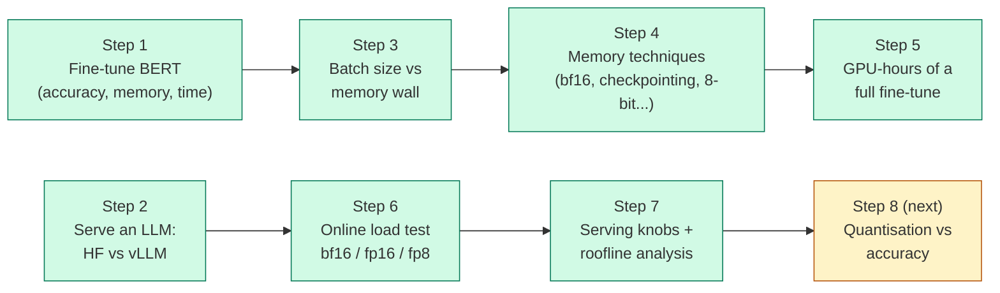

Two tracks share one method: **change one thing, measure it with a script, keep the log, state what the number does and does not prove.**
Training track (Steps 1, 3, 4, 5) uses BERT-base on tweet sentiment. Serving track (Steps 2, 6, 7) uses Qwen2.5-1.5B-Instruct on vLLM.

---

## 3. Plain-language primer (read this first if the terms are new)

<details>
<summary><b>Click to open: the ten terms used everywhere</b></summary>

| Term | Meaning |
|---|---|
| **Token** | A chunk of text (roughly a word piece). Models read and write one token at a time. |
| **Prefill** | Reading the prompt. All prompt tokens are processed together, so the GPU does big matrix multiplications and is limited by **compute**. |
| **Decode** | Writing the answer, one token per step. Each step reads every model weight but does little arithmetic, so it is limited by **memory bandwidth**. |
| **KV cache** | The model's memory of earlier tokens, kept so it need not recompute them. It grows with every token and every concurrent request. |
| **Batching** | Processing several requests in one step. Reading the weights once serves all of them, so a bigger batch is almost free at first. |
| **Continuous batching** | A server that slots new requests into the running batch the moment space frees up, instead of waiting for the whole batch to finish. |
| **Throughput** | Total tokens (or requests) per second. What the owner of the GPU cares about. |
| **Latency, p50, p99** | Time for one request. p50 = the typical request; p99 = the slowest 1 in 100. What the user cares about. |
| **TTFT / TPOT** | Time to first token (how long before the answer starts) / time per output token (how fast it streams). |
| **Goodput** | Requests per second that meet a latency target. Raw throughput can look great while most users wait too long. |

</details>

---

## 4. Simulations you can watch

These animations are generated by [`src/make_simulations.py`](src/make_simulations.py). The serving model behind them is fitted to the measured
bf16 load test: **decode step time = 4.73 ms + 0.0199 ms x (requests in flight)** ([`src/fit_step_model.py`](src/fit_step_model.py)).
They are explanations built on measured data. They are not extra measurements.

### 4.1 Why continuous batching wins

<p align="center">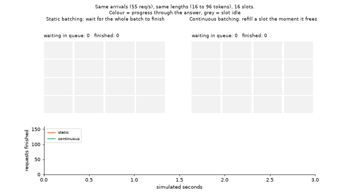</p>

Same arrivals, same answer lengths (16 to 96 tokens), 16 slots. **Static batching** (left) cannot start new work until every slot in the
batch finishes, so short answers leave grey idle slots. **Continuous batching** (right) refills a slot the instant it frees. In this 3-second
simulated window: static finished 96 requests with mean latency 751 ms; continuous finished 144 with mean latency 273 ms. The size of the gap
depends on how varied the answer lengths are; this is an illustration of the mechanism, not a benchmark.

### 4.2 Why latency explodes near capacity

<p align="center">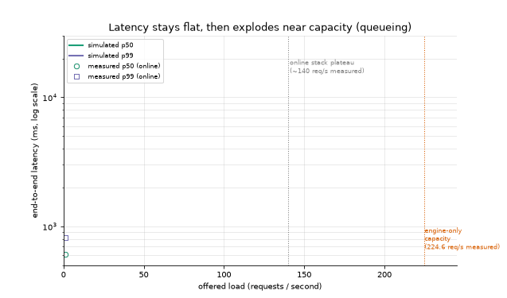</p>

The lines are the simulated p50 and p99; the hollow markers are the **measured** online results. Up to 128 requests/s the simulation tracks the
measured median within 4.4% on average (8.2% worst), which is consistency with the data it was fitted on, not independent proof. Past about 140 req/s the real server
leaves the simulation: the real one is held back by the Python API stack, the simulated engine has no such limit and runs on to roughly 200 req/s.
That gap is itself a finding (see [Step 7](#step-7--serving-knobs-and-a-roofline-check)). The one held-out check: the model extrapolated to 256 sequences predicts
26.1k tokens/s against the 28.75k measured with no HTTP layer (9% low).

### 4.3 Why decode batching is nearly free at first

<p align="center">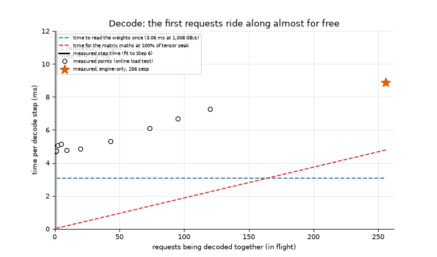</p>

A decode step must read the 3.09 GB of bf16 weights once: **3.06 ms at the card's 1,008 GB/s**, however many requests share the step. The
arithmetic for each extra request costs only 0.019 ms at the card's compute peak. So the first dozens of requests ride along almost for free and
the measured step time rises slowly (4.7 ms alone, 7.3 ms with about 120 in flight). The measured line sits about 1.7 ms above the bandwidth bound
at one request: that gap is per-step overhead (launches, attention, sampling) that more bandwidth would not remove.

### 4.4 The training memory wall

<p align="center">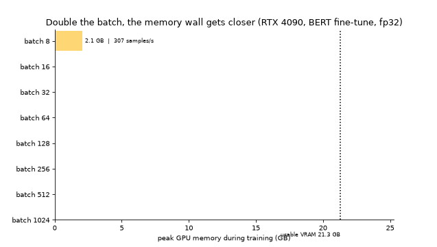</p>

These bars are real measurements (Step 3): each doubling of the batch roughly doubles the activation memory until batch 1024 fails.

### 4.5 The interactive version

[`docs/simulator.html`](docs/simulator.html) has three tabs. **Tabs 1 and 2 look up measured results** (any technique and batch size, any precision and offered load);
**tab 3 runs the simulation** with sliders for arrival rate, concurrency cap and answer length. Its logic was tested in a JavaScript engine against the saved results (16 checks, including a smoke run of 126 control settings; see
[`scripts/test_simulator.py`](scripts/test_simulator.py)). Canvas drawing and layout were not tested in a real browser, so open it and report anything that looks off.

---

## 5. Step by step results

### Step 1 — Fine-tuning BERT on tweets

BERT-base fine-tuned on `cardiffnlp/tweet_eval` (sentiment: negative, neutral, positive). 5,000 consecutive rows (train-split rows 0 to 4,999), split 70/15/15
with seed 2122 (3,500 / 750 / 750). fp32, AdamW at lr 2e-5, batch 32, 4 epochs. Code: [`src/train_bert.py`](src/train_bert.py).

| Epoch | Train loss | Val loss | Val accuracy |
|---|---|---|---|
| 1 | 0.889 | 0.722 | 67.1% |
| **2** | 0.623 | **0.706** | **68.5%** |
| 3 | 0.406 | 0.845 | 67.3% |
| 4 | 0.224 | 0.955 | 67.1% |

Validation stopped improving at **epoch 2**; the model then overfits (train loss keeps falling, validation loss rises). Test accuracy **66.5%**, peak GPU memory
**2.47 GB**, training time **23.0 s**. Worst class by F1 is *negative* (precision 0.50, recall 0.77): the model over-predicts it, often misreading sarcasm and implied criticism.

<details>
<summary>Confusion matrix, per-class scores and five misclassified examples</summary>

Rows = true class, columns = predicted (negative, neutral, positive):

```
negative: [ 92  24   4 ]
neutral : [ 69 220  47 ]
positive: [ 22  85 187 ]
```

| Class | Precision | Recall | F1 | Support |
|---|---|---|---|---|
| negative | 0.503 | 0.767 | 0.607 | 120 |
| neutral | 0.669 | 0.655 | 0.662 | 336 |
| positive | 0.786 | 0.636 | 0.703 | 294 |

Full list with a diagnosis for each example: [`results/step1/SUMMARY.md`](results/step1/SUMMARY.md).
</details>

### Step 2 — Serving: vLLM vs Hugging Face

<p align="center">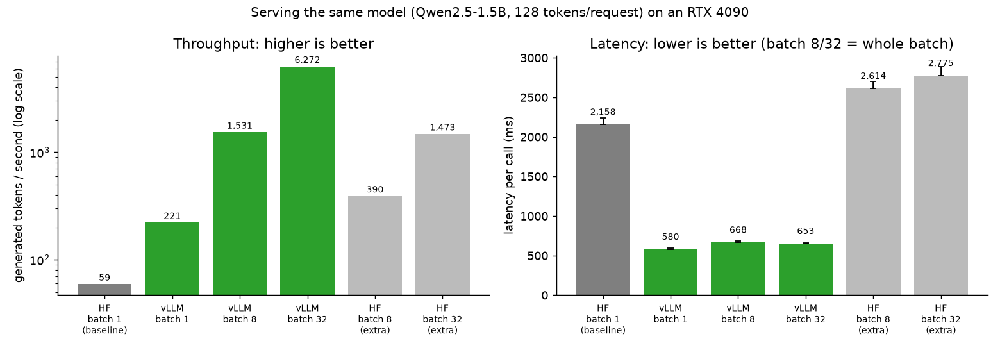</p>

Qwen2.5-1.5B-Instruct, bf16, greedy decoding, exactly 128 new tokens per request, 40 timed calls per configuration. Latency is per generate call (the whole batch at batch 8 and 32).

| Configuration | Tokens/sec | p50 latency (ms) | p95 latency (ms) |
|---|---|---|---|
| HF pipeline, batch 1 (baseline) | 59.1 | 2158.2 | 2239.5 |
| vLLM, batch 1 | 221.3 | 579.6 | 598.3 |
| vLLM, batch 8 | 1530.7 | 668.1 | 681.2 |
| vLLM, batch 32 | 6272.1 | 652.9 | 655.9 |
| *HF pipeline, batch 8 (extra)* | 390.4 | 2613.6 | 2699.0 |
| *HF pipeline, batch 32 (extra)* | 1473.2 | 2775.0 | 2884.6 |

**Reading it:** plain Hugging Face gets slower per request as it batches (+21% at batch 8) while throughput rises. vLLM's latency barely moves (+15% from batch 1 to 8 for 6.9x the throughput).
HF's batch-1 speed (about 17 ms per token) looks dominated by per-step overhead rather than arithmetic, and vLLM's CUDA graphs are a plausible reason it is faster at batch 1; that was not isolated. For an interactive app the latency number matters; for batch jobs and cost, throughput does.
Write-up: [`results/step2/ANALYSIS.md`](results/step2/ANALYSIS.md).

### Step 3 — Batch size and the memory wall

<p align="center">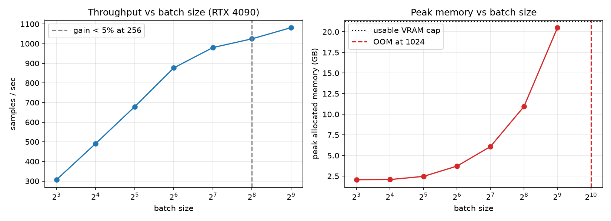</p>

The Step 1 fine-tune with the batch doubled until it ran out of memory (one fresh process per size, allocator capped at the usable VRAM so overflow is a real error).

| Batch | Samples/s | Peak memory (GB) |
|---|---|---|
| 8 | 307 | 2.06 |
| 32 | 679 | 2.47 |
| 128 | 980 | 6.09 |
| 256 | 1,025 | 10.94 |
| **512** | **1,081** | 20.50 |
| 1024 | out of memory | n/a |

Throughput stops improving around batch 128 to 256 (gain under 5% per doubling at 256); after that a bigger batch only costs memory. Peak memory is about **1.45 GB fixed plus 38 MB per sample**.
One lesson cost 22 minutes: without a memory cap, the Windows driver silently spilled GPU memory into system RAM and the run crawled at 100% utilisation instead of failing.
The cross-card comparison the assignment asks for was not possible with one card; the reasoning is in [`results/step3/ANALYSIS.md`](results/step3/ANALYSIS.md).

### Step 4 — Memory techniques, one at a time

<p align="center">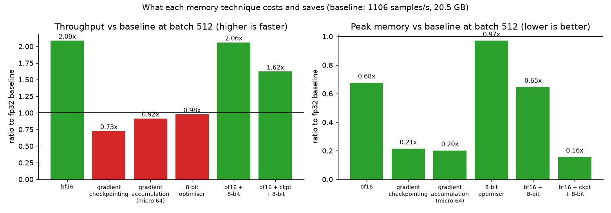</p>

| Technique | Max batch | Throughput (samples/s) | Peak memory (GB) | Test accuracy |
|---|---|---|---|---|
| Baseline (fp32) | 512 | 1105.9 | 20.50 | 66.53% |
| bf16 mixed precision | 512 | 2306.6 | 13.86 | 66.53% |
| Gradient checkpointing | 2048 | 823.3 | 13.86 | 66.53% |
| Gradient accumulation (micro-batch 64) | 2048+ (cap, no OOM) | 1027.6 | 4.14 | 66.67% |
| 8-bit optimiser | 512 | 1081.3 | 19.90 | 67.20% |
| bf16 + 8-bit optimiser | 512 | 2278.9 | 13.24 | 65.87% |
| bf16 + checkpointing + 8-bit optimiser | 2048 | 1854.6 | 10.93 | 65.87% |

**Reading it:** bf16 is the only free lunch (the card's tensor cores run bf16 much faster than fp32). Checkpointing buys memory by recomputing (-27% speed). Accumulation keeps memory flat
while the effective batch grows. The 8-bit optimiser saves about 1 GB at small batches but only 0.6 GB at batch 512, because activations dominate. Accuracy differences are within noise
(750 test rows, one seed): **no technique is shown to help or hurt accuracy.** Full comparison: [`results/step4/ANALYSIS.md`](results/step4/ANALYSIS.md).

<details>
<summary>Throughput and memory curves for every technique</summary>
<p align="center">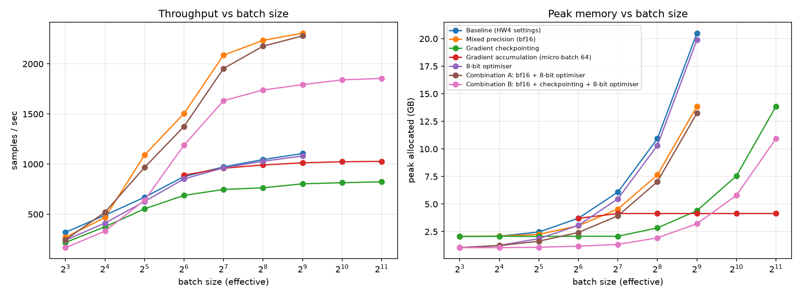</p>
</details>

### Step 5 — What a full fine-tune costs

<p align="center">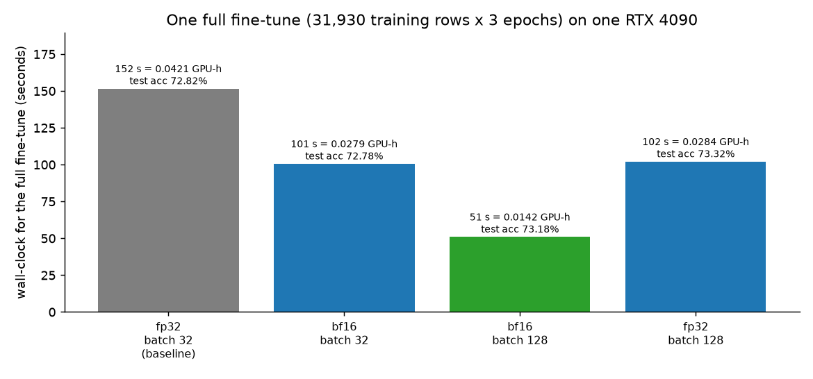</p>

Full fine-tune = all 45,615 train-split rows (31,930 after the 70/15/15 split) for 3 epochs.

```
samples processed = 31,930 x 3 = 95,790
predicted seconds = 95,790 / measured step throughput        (baseline: 95,790 / 669.8 = 143 s)
GPU-hours         = measured wall-clock seconds / 3600       (baseline: 152 / 3600 = 0.0421)
```

The prediction from the Step 4 sweep landed within about 10% of the real run. **Recommended configuration: bf16 autocast at batch 128**, nothing else: it is the only technique that raises throughput,
memory is not the constraint on a 24 GB card (4.55 GB used), and batch 128 sits at the throughput knee. It cuts GPU-hours **3.0x** with test accuracy 73.18% vs 72.82%, a difference within noise.
Summary file: [`METRICS.md`](METRICS.md).

### Step 6 — Online load test: bf16, fp16, fp8

<p align="center">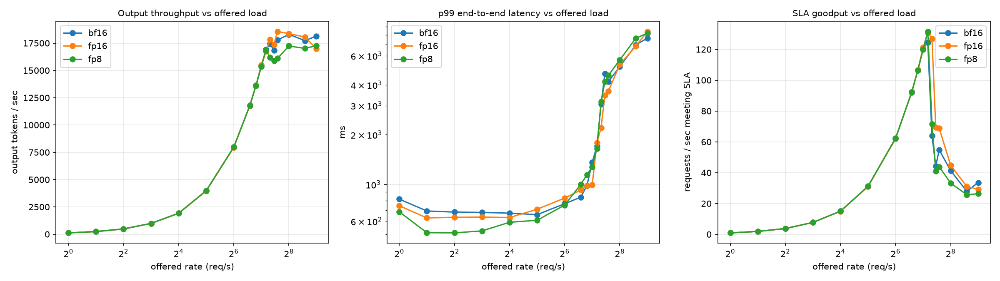</p>

A real `vllm serve` driven by an open-loop client: requests arrive on a Poisson schedule whether or not the server has caught up, so queueing shows up in the numbers (Step 2 could not show it).

| Precision | Weights (GiB) | KV cache (tokens) | Low-load p50 latency | Low-load time per token | SLA capacity (req/s, grid-limited) | Peak tok/s |
|---|---|---|---|---|---|---|
| bf16 | 2.98 | 397,968 | 617 to 671 ms | 4.7 to 5.2 ms | 128 | 18,301 |
| fp16 | 2.98 | 398,112 | 592 to 623 ms | 4.5 to 4.8 ms | 144 | 18,564 |
| fp8 | 1.73 | 436,080 | **497 to 506 ms** | **3.8 to 3.9 ms** | 144 | 17,265 |

- **bf16 and fp16 are indistinguishable** (same width, same memory); differences under about 15 to 20% at a single point are noise.
- **FP8 lowers latency at low load** by roughly 16 to 25%, because with few requests in flight decoding is limited by reading weights and FP8 halves those bytes.
- **FP8 gives no throughput gain at saturation** (engine-only run at 256 sequences: 28,754 tokens/s for bf16 vs 28,730 for fp8). Under mid-to-high load FP8 looked slower in the online test; that is suggestive, not established, and the engine-only run does not show it.
- **The plateau is the serving stack, not the GPU:** the bare engine reaches 28.7k tokens/s, 57% above the online ceiling.

Details and caveats: [`results/step6/ANALYSIS.md`](results/step6/ANALYSIS.md).

### Step 7 — Serving knobs and a roofline check

<p align="center">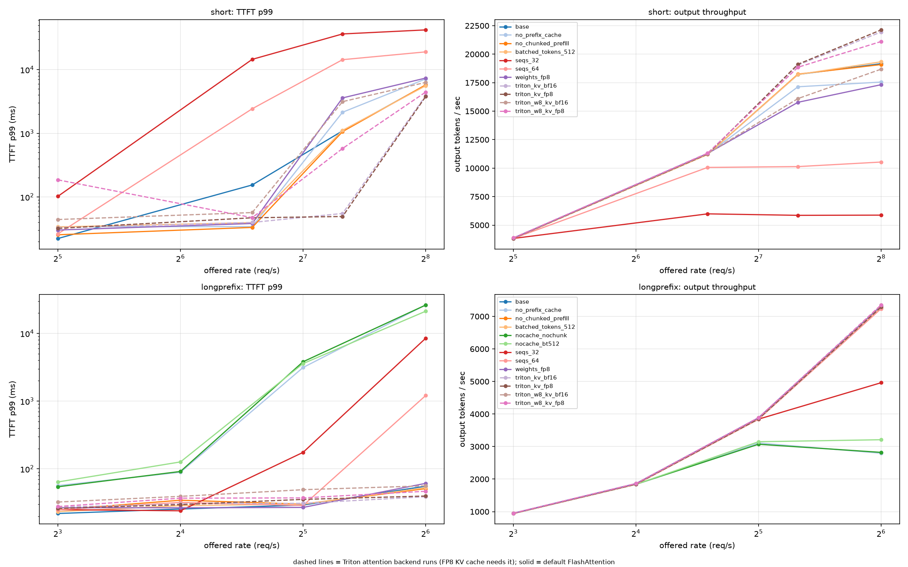</p>

First, what limited the Step 6 plateau? Output tokens/s at 384 offered req/s:

| Setup | tok/s |
|---|---|
| 1 API server, 1 client (Step 6) | 18,689 |
| 1 API server, 4 client processes | 15,786 |
| 4 API servers, 1 client | 21,472 |
| 4 API servers, non-streaming | 21,366 |
| Engine only, no HTTP | 28,754 |

More API-server processes helped by about 15%; more client processes and turning streaming off did not. About a quarter of the gap to the bare engine is unexplained (the API path was not profiled).

Then the knobs, each changed alone, on two workloads (short chat prompts, and a long shared 950-token document):

| Knob | What happened |
|---|---|
| `max-num-seqs` 256 → 64 → 32 | Peak throughput 19.2k → 10.5k → 6.0k tok/s; matches (sequences in flight) / (time per step) within 3%. Too low a cap shows up as queueing, not slow tokens. |
| Prefix caching off (shared document) | Peak throughput **-57%**, SLA capacity 16 vs at least 64 req/s, TTFT p99 3,141 ms vs 29 ms at 32 req/s. Small effect on short prompts. |
| Chunked prefill / batched-token limit | No effect while prefix caching hides the prefill. With caching off and the server overloaded, a 512-token budget cut time per token from 48 to 19 ms but raised median TTFT from 211 to 1,262 ms: a latency trade-off. |
| FP8 KV cache | KV capacity **2.0x** (386k → 772k tokens) with no measurable speed change. Accuracy was **not measured**. Needed a different attention backend (see limits). |
| FP8 weights | Lower low-load latency, no gain under load, +6.8% KV capacity. |

**Roofline check:** a bf16 decode step reads about 3.09 GB, which is 3.06 ms at 1,008 GB/s; the measured step is 4.74 ms (65% of the bandwidth bound). FP8 weights read about 58% of the bytes
but the step only fell to 81% of bf16's, consistent with a fixed per-step cost near 2 ms that does not shrink with weight size (an inference from two points, not a profile).
Full write-up: [`results/step7/ANALYSIS.md`](results/step7/ANALYSIS.md).

---

## 6. Number formats: FP32, FP16, BF16, FP8 and FP4

| Format | Bits | Layout (sign / exponent / mantissa) | Largest value | Used here |
|---|---|---|---|---|
| FP32 | 32 | 1 / 8 / 23 | about 3.4e38 | Training baseline |
| **BF16** | 16 | 1 / 8 / 7 | about 3.4e38 (same range as FP32, less precision) | Mixed-precision training, serving |
| **FP16** | 16 | 1 / 5 / 10 | 65,504 (more precision, narrow range) | Serving |
| **FP8** | 8 | 1 / 4 / 3 (E4M3) or 1 / 5 / 2 (E5M2) | 448 (E4M3), 57,344 (E5M2) | vLLM FP8 weights; FP8 KV cache |
| FP4 | 4 | 1 / 2 / 1 (E2M1) | 6 | **Not possible on this card** |

The RTX 4090 (Ada Lovelace) has tensor cores for FP16, BF16 and FP8, so FP8 is the lowest precision it computes natively. **True FP4 compute needs Blackwell GPUs.** On a 4090, "4-bit" can only mean
storing weights in 4 bits and converting back to 16-bit before the maths: that saves memory and bandwidth but is not 4-bit arithmetic, and it is not what this project calls FP4.
FP8 here means vLLM's per-tensor online quantisation of 112 transformer linear layers (28 each of the four projection types); the output head is not in that list, so it stays in bf16.

---

## 7. What to turn when: a decision guide

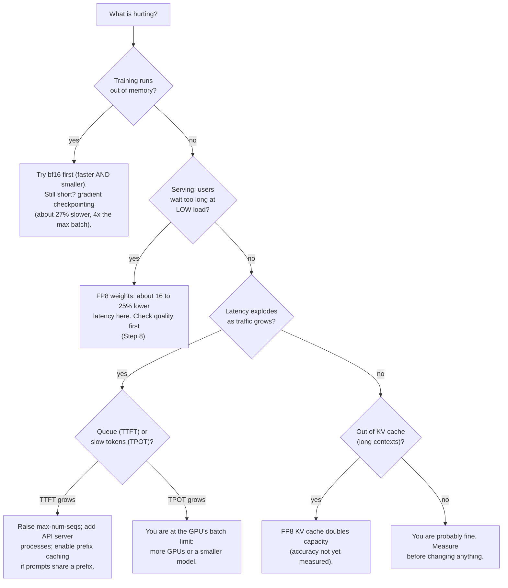

---

## 8. Honest limits

- **One GPU, one seed, one run per measurement.** Differences under roughly 15 to 20% at a single point are not distinguishable from noise. The assignment's second card and the cross-card ratio were not measured.
- **Accuracy was only measured for the training techniques**, and only on small test sets (750 rows in Step 4; standard error about 1.7 points). **Accuracy of FP8 weights and FP8 KV cache was not measured yet** (Step 8).
- **Absolute online capacity depends on the Python API stack**, not just the GPU. Compare configurations against each other, not against the engine ceiling.
- **The FP8 KV cache runs use a different attention backend (Triton)**, because the default FlashAttention does not support it and the FlashInfer fallback failed to build here (a CUDA compiler/header version mismatch).
  Matching bf16 controls on the same backend are reported alongside. That backend looked about 15% faster at high load in one run; this is within noise, so no conclusion is drawn.
- **Large training batches are sampled with replacement** from the 3,500 training rows: they measure step speed and memory, not convergence.
- **The simulations are models fitted to this data**, not additional measurements. The latency model has a 4.4% mean error on the data it was fitted to and was 9% low on one held-out point (and 33% low for FP8).
- **The cost per million tokens uses an assumed $0.50 per GPU-hour**; the GPU is owned. GPU-seconds per million tokens (about 59 to 65) is the price-free number.
- Several mistakes were made and caught during the work (a stalled run from silent memory spilling, a wrong compute-ceiling figure from search results, a misleading "% of peak" column, a missing plotting package). Each is recorded in the relevant `ANALYSIS.md` or [`GPU_HOURS_RECORD.md`](GPU_HOURS_RECORD.md).

---

## 9. Reproduce it

<details>
<summary><b>Environment setup (Windows + WSL2 Ubuntu, NVIDIA driver on Windows)</b></summary>

```bash
# 1. Two virtual environments: training (pinned older stack) and serving (vLLM brings its own PyTorch)
python3.12 -m venv ~/gpu-assignment/.venv
. ~/gpu-assignment/.venv/bin/activate
pip install torch==2.5.1 --index-url https://download.pytorch.org/whl/cu121
pip install -r requirements.txt

python3.12 -m venv ~/gpu-assignment/.venv-vllm
. ~/gpu-assignment/.venv-vllm/bin/activate
pip install vllm matplotlib

# 2. A C compiler is needed by vLLM's Triton component
sudo apt install -y build-essential
```

`scripts/env_vllm.sh` activates the serving environment and sets the two workarounds this project needed
(`CUDA_HOME` pointing at the pip-installed toolkit and `VLLM_USE_FLASHINFER_SAMPLER=0`). Exact package versions of every run are in `logs/stepN/pip_freeze.txt`.
</details>

<details>
<summary><b>Run each step</b> (from the repository root, inside WSL)</summary>

```bash
bash scripts/step1_run.sh          # BERT fine-tune, metrics, GPU UUID capture
bash scripts/step2_run.sh          # HF pipeline vs vLLM  (+ scripts/step2_demo.sh for the prompt demo)
bash scripts/step3_run.sh          # batch size to the memory wall
bash scripts/step4_run.sh          # memory techniques one at a time
bash scripts/step5_run.sh          # full-dataset fine-tune, GPU-hours
bash scripts/step6_run.sh          # online load test: bf16 / fp16 / fp8
bash scripts/step6_engine_check.sh # engine-only control (no HTTP)
bash scripts/step7_diag.sh; bash scripts/step7_diag2.sh   # what limited the plateau
bash scripts/step7_run.sh          # knob sweep (two workloads)

# regenerate the README figures, simulations and interactive page from the saved results
python src/make_readme_figures.py
PYTHONPATH=src python src/make_simulations.py
PYTHONPATH=src python src/build_simulator.py
python scripts/test_simulator.py   # needs: pip install quickjs
```
</details>

---

## 10. Repository map

```
README.md                  you are here
METRICS.md                 summary of the memory/throughput work and the recommended configuration
AI_USE.md                  how AI assistance was used and checked
RUN_LOG.txt                every scripted run with timestamps and the GPU UUID
GPU_HOURS_RECORD.md        GPU time used, including unlogged items (estimates, labelled)
RESERVATION.md             hardware record (own GPU, no reservation)
docs/simulator.html        interactive explorer (open in a browser)
docs/img/                  README figures and simulation animations
src/                       training, benchmark, load-test, report and simulation code
scripts/                   one runner per step, plus environment and test helpers
results/stepN/             tables, charts, raw JSON, and an ANALYSIS.md per step
logs/stepN/                full logs, nvidia-smi captures, package versions, GPU UUID
prompts/                   the prompts used in the vLLM demo
```

---

## 11. What is next

- **Step 8: quantisation with accuracy.** Compare FP16, BF16, FP8 weights, FP8 KV cache and 4-bit weight-only on speed, memory *and* measured quality (perplexity and a task score),
  since "faster with the same quality" is the claim that needs support. This is where the open FP8-KV accuracy question gets answered.
- **Later:** a custom GPU kernel (Triton) benchmarked against the baselines, and, if hardware allows, a real FP4 run on a Blackwell GPU.
